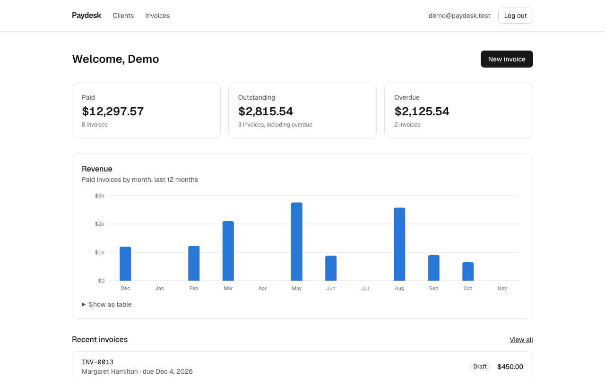
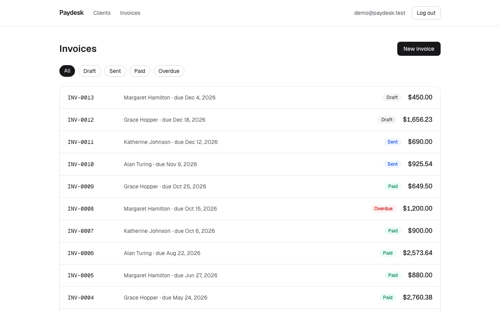
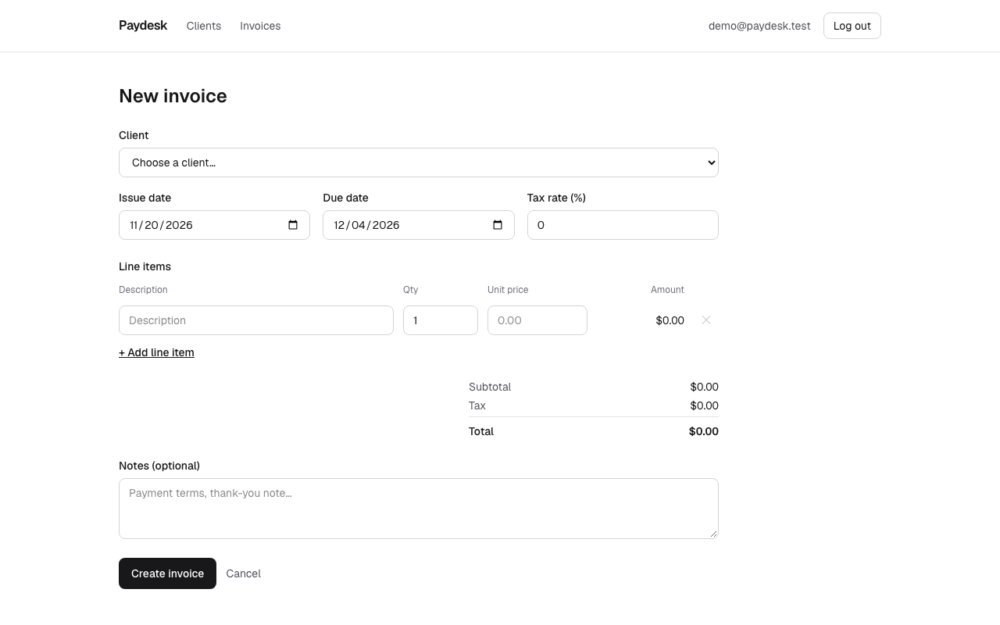
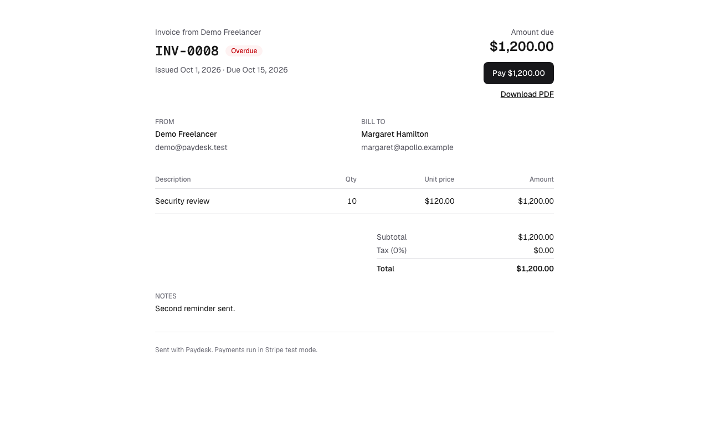
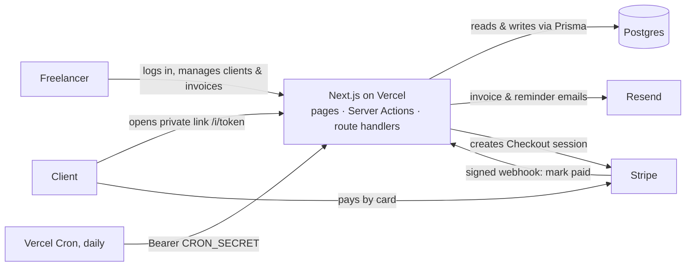
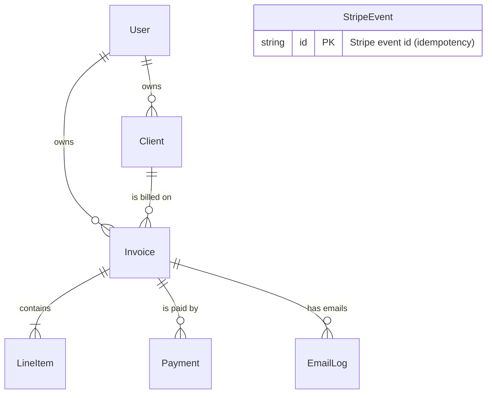

# Paydesk

**Paydesk** is a full-stack invoicing and payments app where freelancers manage clients, create invoices, email them, and get paid online through Stripe. Clients pay from a public link without creating an account.

> 🔗 **Live demo:** [paydesk-theta.vercel.app](https://paydesk-theta.vercel.app) · Payments run in **Stripe test mode**, so no real money moves.
>
> 🚧 **Status:** All features are built and tested. On the live demo, sending email and taking payments switch on once their service keys are added; see the [roadmap](#roadmap).

[](https://github.com/avshr1/paydesk/actions/workflows/ci.yml)

---

## Screenshots

|                                                                                 |                                                                               |
| ------------------------------------------------------------------------------- | ----------------------------------------------------------------------------- |
|       |             |
| **Dashboard:** paid, outstanding, and overdue totals, plus 12 months of revenue | **Invoices:** every invoice, filterable by status                             |
|            |   |
| **New invoice:** line items and tax, with a live total                          | **Client view:** the private link the client opens to view, download, and pay |

Screenshots are generated from demo data with `npm run screenshots`.

## Features

- **Authentication**: email/password and Google login, with protected routes
- **Clients**: create, edit, archive, and list clients
- **Invoices**: multiple line items, tax, due dates, and notes, with totals calculated on the server
- **Statuses**: Draft → Sent → Paid, plus Overdue
- **Email delivery**: send clients a link to a public invoice page
- **Online payments**: Stripe Checkout, with a webhook that marks the invoice paid
- **PDF export**: download any invoice as a PDF
- **Dashboard**: paid, outstanding, and overdue totals, plus monthly revenue
- **Overdue reminders**: a daily scheduled job that emails clients about late invoices

## Tech Stack

| Area       | Technology                                                                     |
| ---------- | ------------------------------------------------------------------------------ |
| Framework  | Next.js (App Router), React, TypeScript (strict mode)                          |
| Styling    | Tailwind CSS                                                                   |
| Database   | PostgreSQL ([Prisma Postgres](https://www.prisma.io/postgres)) with Prisma ORM |
| Auth       | Auth.js (Credentials + Google)                                                 |
| Payments   | Stripe Checkout + webhooks                                                     |
| Email      | Resend                                                                         |
| Validation | Zod on every form and API route                                                |
| Testing    | Vitest (unit), Playwright (end-to-end)                                         |
| CI/CD      | GitHub Actions, deployed on Vercel                                             |

## Engineering Highlights

These are the decisions I'd point to in this codebase:

- **Money is never a float.** All amounts are stored as integer cents, tax as basis points (`825` = 8.25%), and quantities as hundredths (`150` = 1.5 hours). This avoids floating-point errors like `0.1 + 0.2 = 0.30000000000000004`.
- **The server never trusts client-side totals.** The browser shows a live preview, but the server recalculates every total from the line items using one fully unit-tested function.
- **Webhooks are idempotent.** Stripe can deliver the same event more than once. Each event ID is recorded in a `StripeEvent` table in the same database transaction that marks the invoice paid, so a duplicate event is never processed twice.
- **Webhook signatures are verified.** Every request to the webhook endpoint is checked against the Stripe signing secret before anything else happens.
- **Public links are unguessable.** Invoice pages use a cryptographically random token, not the database ID.
- **Financial records can't be silently deleted.** Clients with invoices are archived instead of deleted, and sent invoices are locked from editing.
- **Every input is validated.** Zod schemas guard all forms, Server Actions, route handlers, and environment variables.
- **Reminders can't double-send.** The daily job claims each reminder in the database before emailing, so overlapping runs skip it; a failed email undoes its claim and is retried the next day.
- **Usable without a mouse.** Every page passes automated WCAG 2.1 AA checks in light and dark mode, has a skip link and a main landmark, and shows a visible focus indicator at every Tab stop; CI checks all of this.
- **No real money by accident.** Only Stripe test-mode keys are accepted, and the scheduled job only runs with its secret.

## Architecture



Everything runs in one Next.js app. Freelancer pages require login; the client's invoice page, PDF, and Pay button are reached only through an unguessable link. Totals, ownership, and payment status are always decided on the server.

## Data Model



The full schema is in [`prisma/schema.prisma`](prisma/schema.prisma).

## Getting Started

### Prerequisites

- Node.js (LTS)
- Docker (for a local Postgres database)
- A Stripe account (test mode) and the [Stripe CLI](https://docs.stripe.com/stripe-cli)
- A Resend account

### Setup

```bash
git clone https://github.com/avshr1/paydesk.git
cd paydesk
npm install

cp .env.example .env        # then fill in the values
docker compose up -d        # start local Postgres
npx prisma migrate dev      # create the database tables
npm run db:seed             # optional: demo account with sample data
npm run dev                 # http://localhost:3000
```

The seed creates `demo@paydesk.test` (password `demo-password`) with clients and invoices in every status. It only runs against a local database.

In a second terminal, forward Stripe webhooks to your local server:

```bash
stripe listen --forward-to localhost:3000/api/webhooks/stripe
```

Pay test invoices with card `4242 4242 4242 4242`, any future expiry date, and any CVC.

### Environment Variables

| Variable                                | Purpose                                                                   |
| --------------------------------------- | ------------------------------------------------------------------------- |
| `DATABASE_URL`                          | Pooled Postgres connection string                                         |
| `DIRECT_URL`                            | Direct Postgres connection (used for migrations)                          |
| `AUTH_SECRET`                           | Secret for signing Auth.js tokens                                         |
| `AUTH_GOOGLE_ID` / `AUTH_GOOGLE_SECRET` | Google OAuth credentials                                                  |
| `STRIPE_SECRET_KEY`                     | Stripe API key (test mode only; live keys are rejected)                   |
| `STRIPE_WEBHOOK_SECRET`                 | Used to verify webhook signatures                                         |
| `RESEND_API_KEY`                        | Sends transactional email                                                 |
| `EMAIL_FROM`                            | Sender address for invoices                                               |
| `CRON_SECRET`                           | Protects the overdue-reminder endpoint                                    |
| `APP_URL`                               | Base URL used in emailed links (defaults to the Vercel production domain) |

Only `DATABASE_URL` is required. Each feature that needs a service key explains that it isn't set up yet instead of failing.

## Testing

```bash
npm run test        # Vitest unit tests: money math, webhooks, reminders, validation
npm run build       # end-to-end tests run against a production build
npm run test:e2e    # Playwright: sign-up → client → invoice → PDF, redirects,
                    # axe accessibility checks in light and dark mode,
                    # and keyboard-only navigation with visible focus
```

CI runs lint, typecheck, formatting, unit tests, migrations, the build, and the end-to-end tests against Postgres 17 on every push.

## Roadmap

- [x] **Phase 0:** Project setup, CI, and first deploy
- [ ] **Phase 1:** Authentication (email/password live; Google login built, needs OAuth keys)
- [x] **Phase 2:** Client management
- [x] **Phase 3:** Invoices and total calculations
- [ ] **Phase 4:** Email delivery and public invoice page (built; needs a Resend key)
- [ ] **Phase 5:** Stripe payments and webhooks (built; needs Stripe test keys)
- [x] **Phase 6:** PDF export
- [x] **Phase 7:** Dashboard and revenue chart
- [ ] **Phase 8:** Overdue reminders (built; needs `CRON_SECRET` and email)
- [ ] **Phase 9:** End-to-end tests and polish (payment and email journeys need the keys above)

### Future Ideas

- **Stripe Connect**, so payments go directly to each freelancer's own Stripe account instead of one platform account
- Recurring invoices
- Multi-currency reporting

## License

MIT
