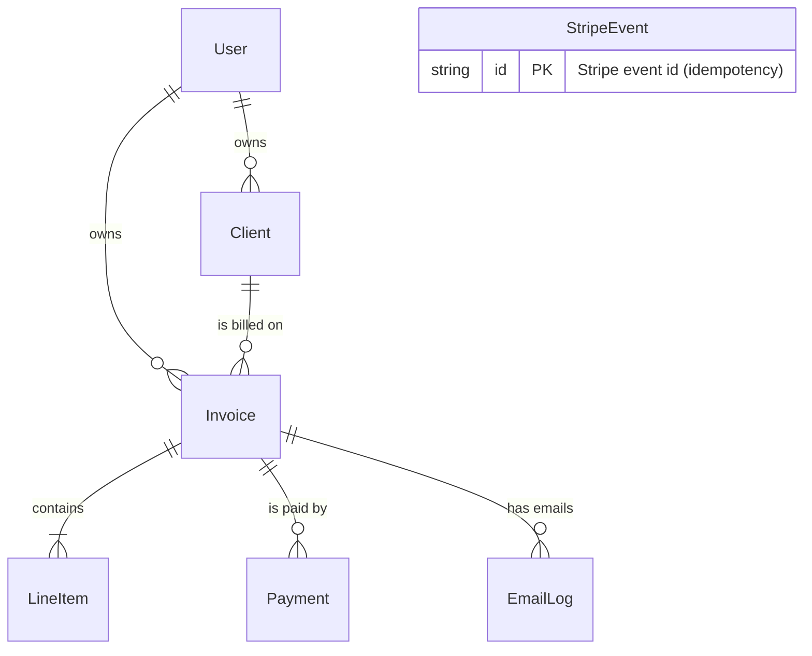

# Paydesk

**Paydesk** is a full-stack invoicing and payments app where freelancers manage clients, create invoices, email them, and get paid online through Stripe. Clients pay from a public link without creating an account.

> 🚧 **Status:** In active development, built in phases. See the [roadmap](#roadmap) for progress.
>
> 🔗 **Live demo:** _coming soon_ · Payments run in **Stripe test mode**, so no real money moves.

[](https://github.com/avshr1/paydesk/actions/workflows/ci.yml)

---

## Features

- **Authentication**: email/password and Google login, with protected routes
- **Clients**: create, edit, archive, and list clients
- **Invoices**: multiple line items, tax, due dates, and notes, with totals calculated on the server
- **Statuses**: Draft → Sent → Paid, plus Overdue
- **Email delivery**: send clients a link to a public invoice page
- **Online payments**: Stripe Checkout, with a webhook that marks the invoice paid
- **PDF export**: download any invoice as a PDF
- **Dashboard**: paid, outstanding, and overdue totals, plus monthly revenue
- **Overdue reminders**: a daily scheduled job that emails clients about late invoices

## Tech Stack

| Area       | Technology                                             |
| ---------- | ------------------------------------------------------ |
| Framework  | Next.js (App Router), React, TypeScript (strict mode)  |
| Styling    | Tailwind CSS                                           |
| Database   | PostgreSQL ([Neon](https://neon.tech)) with Prisma ORM |
| Auth       | Auth.js (Credentials + Google)                         |
| Payments   | Stripe Checkout + webhooks                             |
| Email      | Resend                                                 |
| Validation | Zod on every form and API route                        |
| Testing    | Vitest (unit), Playwright (end-to-end)                 |
| CI/CD      | GitHub Actions, deployed on Vercel                     |

## Engineering Highlights

These are the decisions I'd point to in this codebase:

- **Money is never a float.** All amounts are stored as integer cents, tax as basis points (`825` = 8.25%), and quantities as hundredths (`150` = 1.5 hours). This avoids floating-point errors like `0.1 + 0.2 = 0.30000000000000004`.
- **The server never trusts client-side totals.** The browser shows a live preview, but the server recalculates every total from the line items using one fully unit-tested function.
- **Webhooks are idempotent.** Stripe can deliver the same event more than once. Each event ID is recorded in a `StripeEvent` table in the same database transaction that marks the invoice paid, so a duplicate event is never processed twice.
- **Webhook signatures are verified.** Every request to the webhook endpoint is checked against the Stripe signing secret before anything else happens.
- **Public links are unguessable.** Invoice pages use a cryptographically random token, not the database ID.
- **Financial records can't be silently deleted.** Clients with invoices are archived instead of deleted, and sent invoices are locked from editing.
- **Every input is validated.** Zod schemas guard all forms, Server Actions, route handlers, and environment variables.

## Data Model



The full schema is in [`prisma/schema.prisma`](prisma/schema.prisma).

## Getting Started

### Prerequisites

- Node.js (LTS)
- Docker (for a local Postgres database)
- A Stripe account (test mode) and the [Stripe CLI](https://docs.stripe.com/stripe-cli)
- A Resend account

### Setup

```bash
git clone https://github.com/avshr1/paydesk.git
cd paydesk
npm install

cp .env.example .env        # then fill in the values
docker compose up -d        # start local Postgres
npx prisma migrate dev      # create the database tables
npm run dev                 # http://localhost:3000
```

In a second terminal, forward Stripe webhooks to your local server:

```bash
stripe listen --forward-to localhost:3000/api/webhooks/stripe
```

Pay test invoices with card `4242 4242 4242 4242`, any future expiry date, and any CVC.

### Environment Variables

| Variable                                | Purpose                                          |
| --------------------------------------- | ------------------------------------------------ |
| `DATABASE_URL`                          | Pooled Postgres connection string                |
| `DIRECT_URL`                            | Direct Postgres connection (used for migrations) |
| `AUTH_SECRET`                           | Secret for signing Auth.js tokens                |
| `AUTH_GOOGLE_ID` / `AUTH_GOOGLE_SECRET` | Google OAuth credentials                         |
| `STRIPE_SECRET_KEY`                     | Stripe API key (test mode)                       |
| `STRIPE_WEBHOOK_SECRET`                 | Used to verify webhook signatures                |
| `RESEND_API_KEY`                        | Sends transactional email                        |
| `EMAIL_FROM`                            | Sender address for invoices                      |
| `CRON_SECRET`                           | Protects the overdue-reminder endpoint           |
| `APP_URL`                               | Base URL used in emailed links                   |

## Testing

```bash
npm run test        # Vitest unit tests (invoice math, webhook handling)
npm run test:e2e    # Playwright end-to-end tests
```

## Roadmap

- [ ] **Phase 0:** Project setup, CI, and first deploy
- [ ] **Phase 1:** Authentication
- [ ] **Phase 2:** Client management
- [ ] **Phase 3:** Invoices and total calculations
- [ ] **Phase 4:** Email delivery and public invoice page
- [ ] **Phase 5:** Stripe payments and webhooks
- [ ] **Phase 6:** PDF export
- [ ] **Phase 7:** Dashboard and revenue chart
- [ ] **Phase 8:** Overdue reminders
- [ ] **Phase 9:** End-to-end tests and polish

### Future Ideas

- **Stripe Connect**, so payments go directly to each freelancer's own Stripe account instead of one platform account
- Recurring invoices
- Multi-currency reporting

## License

MIT
